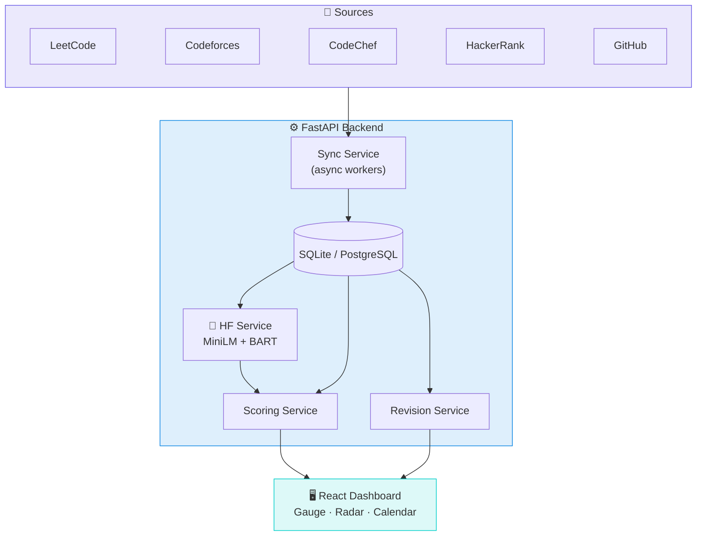
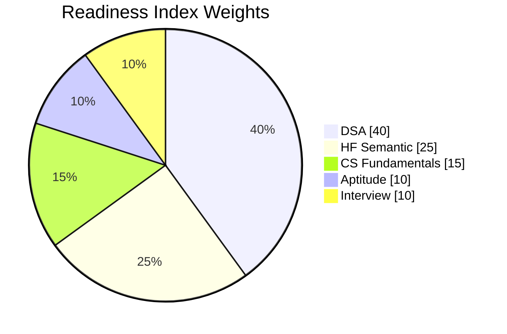

<div align="center">


<a href="https://ao-bwb.pages.dev">
  
</a>

<br/>

[](https://ao-bwb.pages.dev)
[](#-quick-start)
[](#-contributing)


[✨ Features](#-features) · [🧬 How it works](#-how-it-works) · [🚀 Quick start](#-quick-start) · [🗂 Structure](#-project-structure) · [🧪 Testing](#-testing) · [🛡 Design](#-design-decisions)

</div>

<br/>

> [!NOTE]
> **AlgoOrbit** is built for B.Tech CSE students preparing for campus placements. It removes manual problem logging, then answers three questions: *How ready am I? What should I fix first? When should I revise?*

<!--
📸 Add a dashboard screenshot or GIF here:
<p align="center"></p>
-->

## ✨ Features

<table>
<tr>
<td valign="top" width="50%">

#### 🔄 Auto Sync
Live submissions, ratings and tags from **LeetCode**, **Codeforces**, **CodeChef**, **HackerRank** and **GitHub**. No spreadsheets.

</td>
<td valign="top" width="50%">

#### 🧠 AI Readiness Score
A composite index from **sentence embeddings** and **zero-shot classification**, not just solve counts.

</td>
</tr>
<tr>
<td valign="top" width="50%">

#### 🏢 Company Match
Cosine similarity of your profile against real JDs for **Tier-1, Mid-Tier and Enterprise** companies.

</td>
<td valign="top" width="50%">

#### 🎯 Weak-Area Radar
Topic priorities weighted by company difficulty and **recency decay**. Stale critical topics get flagged.

</td>
</tr>
<tr>
<td valign="top" width="50%">

#### 🔁 Spaced Repetition
Review calendar on a **1 → 3 → 7 → 14 → 30 day** schedule, tuned by your recall rating.

</td>
<td valign="top" width="50%">

#### 🎤 AI Mock Interviewer
Practice ACID, deadlocks, indexing, TCP/UDP and SOLID. Get **relevance** and **missing-term** feedback.

</td>
</tr>
</table>

<div align="right"><a href="#top">⬆ back to top</a></div>

---

## 🔌 Data Sources

| Platform | Access | Ingested |
|:--|:--|:--|
| 🟠 **LeetCode** | GraphQL | Easy/Medium/Hard split, contest rating, rank, topic counts |
| 🔵 **Codeforces** | REST | Rating, title rank, tag distribution |
| 🟤 **CodeChef** | Profile data | Rating, star tier, global/country rank, problems solved |
| 🟢 **HackerRank** | Profile data | Skill badges, star levels, certifications, progress |
| ⚫ **GitHub** | REST v3 | Public repos, stars, languages, commit recency |

> [!TIP]
> Every sync runs in a **non-blocking FastAPI background worker**, so the UI never freezes.

---

## 🧬 How it works



### 🤗 AI Models

| Model | Job |
|:--|:--|
| [`all-MiniLM-L6-v2`](https://huggingface.co/sentence-transformers/all-MiniLM-L6-v2) | Embeds your prep summary; cosine similarity vs company JDs |
| [`bart-large-mnli`](https://huggingface.co/facebook/bart-large-mnli) | Zero-shot hireability tier prediction with calibrated confidence |

### 📐 The Math

**Placement Readiness Index**

$$\text{Readiness} = 0.40\,\text{DSA} + 0.25\,\text{HF} + 0.15\,\text{CS} + 0.10\,\text{Aptitude} + 0.10\,\text{Interview}$$



**Weak-topic priority**

$$\text{Priority} = (100 - \text{Proficiency}) \times \text{Weight} \times \text{Recency}$$

> [!WARNING]
> Critical topics (**DP, Graphs, Trees**) with **0 solves in 21 days** are flagged 🚨 **Urgent Revision Required**.

**Spaced-repetition ladder:** `Day 1 → 3 → 7 → 14 → 30`

<div align="right"><a href="#top">⬆ back to top</a></div>

---

## 🧰 Tech Stack

<div align="center">

</div>

| Layer | Tools |
|:--|:--|
| **Frontend** | React 18, Vite, Chart.js, glassmorphism CSS |
| **Backend** | FastAPI, SQLAlchemy, Pydantic, Uvicorn |
| **Auth** | Bcrypt, JWT Bearer tokens |
| **AI / NLP** | Hugging Face Transformers, sentence-transformers |
| **Database** | SQLite (zero-config) or PostgreSQL |

---

## 🚀 Quick Start

> [!IMPORTANT]
> **Prerequisites:** Python 3.10+ (3.11 recommended) and Node.js 18+ with npm.

<details open>
<summary><b>⚙️ 1. Backend</b></summary>

```bash
cd backend
python -m venv venv
.\venv\Scripts\activate      # Windows
# source venv/bin/activate   # macOS / Linux
pip install -r requirements.txt
cp .env.example .env
python run.py
```

- API: `http://localhost:8000`
- Swagger: `http://localhost:8000/docs`

</details>

<details open>
<summary><b>🖥 2. Frontend</b></summary>

```bash
cd frontend
npm install
npm run dev
```

Open `http://localhost:5173`. Vite proxies `/api` to `:8000`.

</details>

---

## 🗂 Project Structure

<details>
<summary><b>📁 Explore the repo layout</b></summary>

```
college-placement-system/
├── backend/
│   ├── app/
│   │   ├── api/
│   │   │   ├── routes_auth.py
│   │   │   ├── routes_platforms.py
│   │   │   ├── routes_ai.py
│   │   │   ├── routes_academics.py
│   │   │   └── routes_revision.py
│   │   ├── core/
│   │   │   ├── config.py
│   │   │   ├── database.py
│   │   │   └── security.py
│   │   ├── models/db_models.py
│   │   ├── schemas/pydantic_schemas.py
│   │   ├── services/
│   │   │   ├── leetcode_scraper.py
│   │   │   ├── codeforces_scraper.py
│   │   │   ├── codechef_scraper.py
│   │   │   ├── hackerrank_scraper.py
│   │   │   ├── github_scraper.py
│   │   │   ├── sync_service.py
│   │   │   ├── huggingface_service.py
│   │   │   ├── scoring_service.py
│   │   │   └── revision_service.py
│   │   ├── data/company_benchmarks.json
│   │   └── main.py
│   ├── tests/smoke.py
│   ├── requirements.txt
│   ├── .env.example
│   └── run.py
│
├── frontend/
│   ├── src/
│   │   ├── api/client.js
│   │   ├── components/
│   │   ├── pages/
│   │   ├── styles/global.css
│   │   ├── App.jsx
│   │   └── main.jsx
│   ├── package.json
│   ├── vite.config.js
│   └── index.html
│
├── docs/
│   ├── AI_Model_Architecture.md
│   └── API_Documentation.md
└── README.md
```

| Folder | Purpose |
|:--|:--|
| `api/` | Auth, platform sync, AI, academics, revision routes |
| `core/` | Settings, DB session, bcrypt + JWT |
| `services/` | Scrapers, sync orchestrator, HF models, scoring, spaced repetition |
| `components/` | Gauge, platform cards, radar chart, revision calendar, sync modal |
| `pages/` | Dashboard, coding profiles, AI analysis, CS fundamentals, login, register |

</details>

---

## 🧪 Testing

```bash
cd backend
.\venv\Scripts\python tests/smoke.py   # Windows
# python tests/smoke.py                # macOS / Linux
```

<details>
<summary><b>✅ What the smoke suite verifies</b></summary>

- [x] `GET /api/health` returns `{"status": "ok"}`
- [x] Registration with CS topic seeding
- [x] Login and JWT generation
- [x] `/api/auth/me` works when authed, 401 otherwise
- [x] Connect `leetcode`, `codeforces`, `codechef`, `hackerrank`, `github`
- [x] CS topic update and aptitude quiz submission
- [x] HF evaluation, tier classification, company match
- [x] Spaced-repetition due retrieval and recall recalibration

</details>

---

## 🛡 Design Decisions

<details>
<summary><b>🤔 Why transformers, not a weighted average?</b></summary>
<br/>

Solve counts can't judge portfolio depth or alignment with real JDs. MiniLM embeddings plus cosine similarity catch mismatches raw counts miss.

</details>

<details>
<summary><b>⏱ How are rate limits and downtime handled?</b></summary>
<br/>

Results are cached with a cooldown (`SYNC_COOLDOWN_SECONDS = 600`). On failure the last good snapshot is kept, status becomes `error`, and the user sees a clear diagnostic.

</details>

<details>
<summary><b>🧠 Why spaced repetition?</b></summary>
<br/>

Prep spans months and early topics fade. Reviews are booked at 1, 3, 7, 14, 30 day intervals, tuned by recall.

</details>

<details>
<summary><b>📴 What if Hugging Face is unreachable?</b></summary>
<br/>

A deterministic offline fallback still returns scores and tiers, with `is_fallback: true` in the response.

</details>

---

## 🤝 Contributing

1. 🍴 Fork the repo
2. 🌿 `git checkout -b feature/your-idea`
3. ✅ Run `python tests/smoke.py`
4. 📬 Open a pull request

---

<div align="center">

### ⭐ If AlgoOrbit helps your prep, drop a star

[](https://ao-bwb.pages.dev)


</div>
